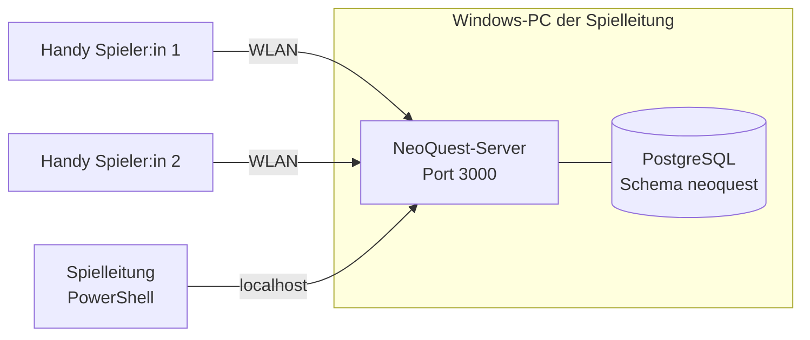
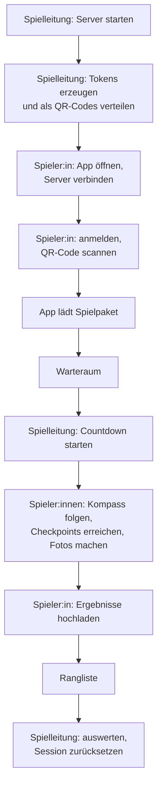

# NeoQuest – Bedienungshandbuch

NeoQuest ist eine GPS-Schatzsuche für das lokale Netz. Spieler:innen folgen mit der App einem Kompass zu Checkpoints, machen dort Fotos und laden am Ende Route, Fotos und Ergebnis hoch. Die Spielleitung betreibt Server und Datenbank auf einem Windows-Rechner im selben WLAN.

Das Handbuch hat zwei Teile:

- **Teil A – Spielleitung:** Installation, Befehle, ein Spiel vorbereiten, starten und auswerten
- **Teil B – Spieler:innen:** App installieren und spielen

Am Ende stehen die [Anwendungsfälle](#anwendungsfälle) im Überblick und die [Fehlerbehebung](#fehlerbehebung).

---

## Überblick



| Rolle | Was sie tut | Womit |
|---|---|---|
| Spielleitung | Server betreiben, Tokens ausgeben, Spiel starten, auswerten | PowerShell auf dem PC |
| Spieler:in | anmelden, Checkpoints ablaufen, Fotos machen, hochladen | NeoQuest-App auf dem Handy |

### Ablauf eines Spiels



---

# Teil A – Spielleitung

## 1. Installation

Die Installation ist einmalig. Alle Befehle sind für **PowerShell**, das Projekt liegt in `C:\dev\neoquest`.

### 1.1 Voraussetzungen

| Software | Version | Wofür |
|---|---|---|
| PostgreSQL | 18 | Datenbank |
| Node.js + npm | ab 18 (getestet mit 26) | Server und Datenbank-Skripte |
| Flutter SDK | 3.50 (stable) | App bauen |
| Android Studio | 2026.2 | Android-SDK, Emulator, App bauen |

### 1.2 Datenbank einrichten

```powershell
cd C:\dev\neoquest\neoquest_db
npm install
Copy-Item .env.example .env      # Zugangsdaten eintragen (siehe unten)
npm run setup:db                 # legt Datenbank, User neoquest_app und Schema an
npm run migrate:up               # legt Tabellen und Beispielspiele an, setzt Rechte
```

In `neoquest_db\.env` gehören:

- `DB_ADMIN_USER` / `DB_ADMIN_PASSWORD`: der PostgreSQL-Superuser (meist `postgres`)
- `DB_USER` / `DB_PASSWORD`: der eingeschränkte App-User `neoquest_app` mit einem eigenen, zufälligen Passwort

Passwörter stehen nur in den lokalen `.env`-Dateien, nie in Dokumenten, Chats oder Commits. Details: [neoquest-db-installation-guide.md](neoquest-db-installation-guide.md).

### 1.3 Server einrichten

```powershell
cd C:\dev\neoquest\neoquest_server
Copy-Item .env.example .env
```

In `neoquest_server\.env` eintragen:

- `DB_PASSWORD`: dasselbe Passwort wie in `neoquest_db\.env`
- `JWT_SECRET`: eine lange, zufällige Zeichenkette
- `ADMIN_KEY`: ein eigener, langer Admin-Schlüssel für die Spielleitungs-Befehle aus Abschnitt 3. **Pflicht:** Ohne ihn sind alle Admin-Funktionen gesperrt. Einen zufälligen Schlüssel anhängen, ohne ihn anzuzeigen:
  ```powershell
  Add-Content .env ("ADMIN_KEY=" + (node -e "process.stdout.write(require('crypto').randomBytes(32).toString('hex'))"))
  ```
- `ALLOWED_IP_RANGES`: das eigene WLAN, z. B. `10.0.0.0/24` oder `192.168.1.0/24`. Der Server prüft das nur bei `NODE_ENV=production`, bei `development` sind alle Adressen zugelassen.
- `RATE_LIMIT_MAX_REQUESTS`: erlaubte Anfragen pro Gerät in 15 Minuten, empfohlen `1000`. Die Statusabfragen der App im Warteraum und die Admin-Befehle zählen nicht mit.

Server starten und prüfen:

```powershell
cd C:\dev\neoquest
.\start-server.ps1
Invoke-RestMethod http://localhost:3000/health
```

Die Antwort zeigt unter `network_addresses` die **LAN-Adresse des PCs**, zum Beispiel `http://10.0.0.183:3000`. Diese Adresse brauchen die Spieler:innen.

### 1.4 Firewall freigeben

Damit Handys den Server erreichen, muss Windows eingehende Verbindungen auf Port 3000 erlauben. Einmalig in einer **Administrator**-PowerShell:

```powershell
New-NetFirewallRule -DisplayName "NeoQuest Server" -Direction Inbound `
  -Protocol TCP -LocalPort 3000 -Profile Private -Action Allow
```

Das WLAN muss in Windows als **privates** Netzwerk eingestuft sein.

### 1.5 App bauen und verteilen

```powershell
cd C:\dev\neoquest\neoquest_app
flutter pub get
flutter build apk --release
```

Die fertige Datei liegt unter `neoquest_app\build\app\outputs\flutter-apk\app-release.apk`. Verteilen auf zwei Wegen:

- **Per USB-Kabel** (USB-Debugging am Handy aktiv): `adb install build\app\outputs\flutter-apk\app-release.apk`
- **Als Datei:** APK aufs Handy kopieren und dort öffnen. Android fragt einmalig, ob Installationen aus dieser Quelle erlaubt sind.

Zum Testen am PC eignet sich der Emulator. Dort findet die App den Server automatisch unter `10.0.2.2:3000`:

```powershell
flutter emulators --launch Pixel_7
flutter run
```

---

## 2. Befehlsübersicht

### Server

| Befehl | Zweck |
|---|---|
| `.\start-server.ps1` | Server starten, Neustart bei Code-Änderungen |
| `.\start-server.ps1 -Prod` | Server ohne automatischen Neustart starten |
| `Strg+C` | Server beenden |
| `Invoke-RestMethod http://localhost:3000/health` | prüfen, ob Server und Datenbank laufen |
| `npm run lint` / `npm test` (in `neoquest_server`) | Code prüfen und testen |

### Datenbank (in `neoquest_db`)

| Befehl | Zweck |
|---|---|
| `npm run migrate:up` | neue Migrationen einspielen, Rechte setzen |
| `npm run migrate:status` | offene Migrationen anzeigen |
| `npm run migrate:down` | letzte Migration zurücknehmen |
| `npm run migrate:create -- <name>` | neue Migration anlegen |
| `npm run db:grant` | Rechte für `neoquest_app` neu setzen |

### App (in `neoquest_app`)

| Befehl | Zweck |
|---|---|
| `flutter pub get` | Pakete holen |
| `flutter emulators --launch Pixel_7` | Emulator starten |
| `flutter run` | App auf Emulator oder angeschlossenem Handy starten |
| `flutter build apk --release` | Installationsdatei für Handys bauen |
| `flutter doctor` | Entwicklungsumgebung prüfen |

---

## 3. Ein Spiel durchführen

Die Spielleitung steuert das Spiel über die Server-API. Es gibt noch keine eigene Oberfläche dafür. Alle Befehle laufen in PowerShell auf dem Server-PC.

Einmal pro PowerShell-Fenster den Admin-Schlüssel aus `neoquest_server\.env` in eine Variable laden:

```powershell
$adminKey = (Select-String -Path C:\dev\neoquest\neoquest_server\.env -Pattern '^ADMIN_KEY=(.*)').Matches.Groups[1].Value
$h = @{ 'X-Admin-Key' = $adminKey }
$api = 'http://localhost:3000/api'
```

### 3.1 Vorbereitung (am Vortag oder vor Ort)

**1. Server starten** und den Health-Check abwarten (siehe 1.3).

**2. Spiel auswählen.** Verfügbare Spiele mit ID anzeigen:

```powershell
(Invoke-RestMethod "$api/admin/games" -Headers $h).games | Format-Table id, name, is_active
```

Die Beispielspiele aus der Datenbank sind unter anderem die **Möllersdorf Schatzsuche** mit vier Checkpoints (Start Münchendorferstrasse 12, Brücke über den Mühlbach, Bahnschranken, Ziel Bahnhaltestelle Aspangbahn).

**3. Tokens erzeugen.** Jede Spieler:in bzw. jedes Team bekommt ein Token. Beispiel: 6 Tokens für Spiel 1:

```powershell
$body = @{ game_id = 1; count = 6; admin_key = $adminKey } | ConvertTo-Json
$res = Invoke-RestMethod -Method Post "$api/level1/admin/generate-tokens" -ContentType 'application/json' -Body $body
$res.tokens | Format-Table player_name, qr_code_content
```

Der Inhalt eines QR-Codes sieht so aus: `NEOQUEST:QR_TOKEN_1A2B3C…:Möllersdorf Schatzsuche`.

**4. QR-Codes ausgeben.** Den Text aus `qr_code_content` mit einem beliebigen QR-Generator in einen QR-Code umwandeln und ausdrucken, zum Beispiel als Karte pro Team. Ohne Drucker geht es auch so: Die Spieler:innen tippen den Text in der App unter **Manuelle Eingabe** ein.

Bereits erzeugte Tokens eines Spiels lassen sich jederzeit wieder anzeigen:

```powershell
Invoke-RestMethod "$api/admin/tokens-of-game/1" -Headers $h
```

**5. Probelauf.** Mit einem eigenen Handy oder dem Emulator einmal den kompletten Ablauf aus Teil B durchspielen.

### 3.2 Spielstart

**1. Spieler:innen einchecken lassen.** Alle öffnen die App, verbinden sich mit dem Server, melden sich an und scannen ihren QR-Code (Teil B, Schritte 2–5). Danach stehen sie im **Warteraum**.

**2. Prüfen, wer bereit ist:**

```powershell
Invoke-RestMethod "$api/session/admin/players" -Headers $h
```

**3. Countdown starten**, zum Beispiel 30 Sekunden:

```powershell
Invoke-RestMethod -Method Post "$api/session/admin/countdown/30" -Headers $h
```

Die Apps zeigen den Countdown und wechseln danach automatisch zum Kompass. Wer sofort ohne Countdown starten will:

```powershell
Invoke-RestMethod -Method Post "$api/session/admin/start" -Headers $h
```

**Aktueller Spielstatus** (ohne Schlüssel abrufbar, so fragen ihn auch die Apps ab):

```powershell
Invoke-RestMethod "$api/session/status"
```

Die Session durchläuft die Zustände `waiting` (Warteraum) → `countdown` → `started` (Spiel läuft) → `finished`.

### 3.3 Während des Spiels

- Der Server-PC muss eingeschaltet und im WLAN bleiben. Die Apps sammeln Route und Fotos zunächst lokal und laden sie erst am Ende hoch.
- Den Upload-Stand aller Spieler:innen zeigt:
  ```powershell
  Invoke-RestMethod "$api/mission/admin/all-status" -Headers $h
  ```

### 3.4 Auswertung und Abschluss

**Rangliste** eines Spiels:

```powershell
Invoke-RestMethod "$api/mission/leaderboard/1"
```

Die Spieler:innen sehen die Rangliste auch in der App.

**Hochgeladene Fotos** liegen auf dem Server-PC unter `C:\dev\neoquest\neoquest_server\uploads\`. Sie bleiben lokal und kommen nicht ins Git-Repository. Wenn sie aufbewahrt werden sollen, vor dem nächsten Spiel sichern.

**Session zurücksetzen**, damit die nächste Runde wieder im Warteraum beginnt:

```powershell
Invoke-RestMethod -Method Post "$api/session/admin/reset" -Headers $h
```

**Server beenden** mit `Strg+C` im Server-Fenster.

---

# Teil B – Spieler:innen

## 1. App installieren

Die Spielleitung gibt die App als APK-Datei weiter oder installiert sie per Kabel (Teil A, 1.5). Beim ersten Öffnen von Fremd-APKs fragt Android, ob Installationen aus dieser Quelle erlaubt werden sollen.

**Voraussetzungen am Handy:** Android, eingeschaltetes **GPS/Standort**, Kamera, und dasselbe **WLAN** wie der Server-PC.

## 2. Mit dem Server verbinden

1. App öffnen. Nach dem Startbildschirm sucht sie selbst nach dem NeoQuest-Server (*Scanning for NeoQuest servers…*).
2. Wird kein Server gefunden (*No servers found. Enter IP manually.*), unter **Manual Server IP** die Adresse eingeben, die die Spielleitung nennt, zum Beispiel `10.0.0.183:3000`.
3. Bei *Connected successfully!* geht es automatisch weiter.

## 3. Anmelden

1. Auf der Seite **Spielerin Anmeldung** den Namen eintragen (mindestens 2 Zeichen). Die E-Mail ist optional.
2. **Beim Spiel anmelden** tippen.

## 4. QR-Code scannen

1. Die App fragt nach der Kamera-Berechtigung, bitte **erlauben**.
2. Den QR-Code von der Spielleitung scannen.
3. Funktioniert die Kamera nicht: **Manuelle Eingabe** wählen und den Text unter dem QR-Code abtippen (beginnt mit `NEOQUEST:`).

## 5. Spiel laden und warten

1. Die App lädt das Spielpaket (*Downloading Game Package*). Nach *Download Complete!* geht es automatisch weiter.
2. Im **Warteraum** stehen die Spielregeln. Die App wartet, bis die Spielleitung startet:
   - *Please wait until everyone is registered…* – es fehlen noch Mitspieler:innen
   - *The game is starting soon! Get ready!* – der Countdown läuft
   - *The game has begun!* – los geht's
3. Die Standort-Berechtigung **erlauben**, sonst funktioniert der Kompass nicht.

## 6. Spielen

1. **Kompass folgen.** Die Nadel zeigt Richtung nächstem Checkpoint. Die Ringe zeigen, wie nah du bist:

   | Anzeige | Bedeutung |
   |---|---|
   | alle Ringe grau | noch weit entfernt |
   | äußerer Ring grün | auf dem Weg |
   | mittlerer Ring grün | etwa die Hälfte geschafft |
   | innerer Kreis grün gefüllt | Checkpoint erreicht |

2. **Foto machen.** Erscheint *Photo Required!*, auf **Take Photo** tippen, das Motiv fotografieren und mit **Use Photo** bestätigen (oder **Retake** für ein neues Foto).
3. Nach *Checkpoint Reached!* zeigt der Kompass auf den nächsten Checkpoint.
4. Am letzten Checkpoint erscheint *Mission Complete!*.

Tipp: Die App beim Laufen geöffnet lassen. Die Route wird nur aufgezeichnet, solange die App im Vordergrund ist.

## 7. Ergebnisse hochladen

1. Auf **Upload Results** tippen. Die App lädt nacheinander Route, Fotos und das Ergebnis hoch.
2. Dafür muss das Handy wieder im WLAN des Server-PCs sein.
3. Schlägt etwas fehl, mit **Retry Upload** erneut versuchen.
4. Bei *Mission completed successfully!* ist alles angekommen.

## 8. Rangliste

Nach dem Upload zeigt die **Leaderboard** die Platzierungen aller, die das Spiel abgeschlossen haben.

---

## Anwendungsfälle

| Nr. | Anwendungsfall | Akteur | Kurzablauf | Abschnitt |
|---|---|---|---|---|
| UC-1 | System einrichten | Spielleitung | Datenbank, Server, Firewall, App bauen | A 1 |
| UC-2 | Server starten und prüfen | Spielleitung | `start-server.ps1`, Health-Check | A 1.3 |
| UC-3 | Spiel auswählen | Spielleitung | Spiele mit ID auflisten | A 3.1 |
| UC-4 | Tokens und QR-Codes ausgeben | Spielleitung | Tokens erzeugen, QR-Codes drucken oder Text weitergeben | A 3.1 |
| UC-5 | App installieren | Spieler:in | APK installieren, Berechtigungen erlauben | B 1 |
| UC-6 | Mit Server verbinden | Spieler:in | automatische Suche oder IP eingeben | B 2 |
| UC-7 | Anmelden und Token verknüpfen | Spieler:in | Name eingeben, QR-Code scannen oder abtippen | B 3–4 |
| UC-8 | Spielpaket laden und warten | Spieler:in | Download, Warteraum | B 5 |
| UC-9 | Spiel starten | Spielleitung | bereitstehende Spieler:innen prüfen, Countdown | A 3.2 |
| UC-10 | Checkpoints ablaufen | Spieler:in | Kompass folgen, Ringe beachten | B 6 |
| UC-11 | Foto am Checkpoint | Spieler:in | Take Photo, Use Photo | B 6 |
| UC-12 | Ergebnisse hochladen | Spieler:in | Upload Results, ggf. Retry | B 7 |
| UC-13 | Fortschritt verfolgen | Spielleitung | Upload-Stand und Session-Status abfragen | A 3.3 |
| UC-14 | Auswerten | Spielleitung, Spieler:in | Rangliste, Fotos im Ordner `uploads` | A 3.4, B 8 |
| UC-15 | Neue Runde vorbereiten | Spielleitung | Session zurücksetzen, neue Tokens | A 3.4 |

---

## Fehlerbehebung

| Problem | Ursache | Lösung |
|---|---|---|
| Health-Check meldet keine Datenbank | PostgreSQL-Dienst läuft nicht | `Get-Service postgresql*`, als Administrator `Start-Service <Name>` |
| `.env fehlt` beim Serverstart | Server-Konfiguration fehlt | `.env.example` nach `.env` kopieren und ausfüllen (A 1.3) |
| App findet den Server nicht | anderes WLAN, Firewall, falsche IP | gleiches WLAN prüfen, Firewall-Regel (A 1.4), IP aus dem Health-Check manuell eingeben |
| Server antwortet mit `Access denied` | Handy-IP liegt nicht in `ALLOWED_IP_RANGES` (nur bei `NODE_ENV=production`) | eigenes WLAN-Netz in `neoquest_server\.env` eintragen, Server neu starten |
| `Too many requests from this IP` | Anfrage-Limit pro Gerät erreicht | `RATE_LIMIT_MAX_REQUESTS` in `neoquest_server\.env` erhöhen (A 1.3), Server neu starten. Ein Neustart setzt das Limit auch sofort zurück. |
| `Admin access required` (403) | falscher oder fehlender Admin-Schlüssel | `ADMIN_KEY` in `neoquest_server\.env` prüfen, `$h` neu setzen |
| `Admin access not configured` (503) | `ADMIN_KEY` fehlt in `neoquest_server\.env` | Schlüssel ergänzen (A 1.3), Server neu starten |
| QR-Code wird nicht erkannt | Licht, Kamera-Berechtigung | Berechtigung in den Android-Einstellungen erlauben oder **Manuelle Eingabe** |
| Kompass bewegt sich nicht | Standort aus oder nicht erlaubt | GPS einschalten, Standort-Berechtigung erlauben, möglichst im Freien |
| App bleibt im Warteraum | Spielleitung hat noch nicht gestartet | Countdown starten (A 3.2), Status mit `/api/session/status` prüfen |
| Upload schlägt fehl | Handy nicht im Server-WLAN | ins WLAN zurück, **Retry Upload** |
| Build-Fehler beim App-Bau | Entwicklungsumgebung unvollständig | `flutter doctor` ausführen und Hinweise befolgen |
